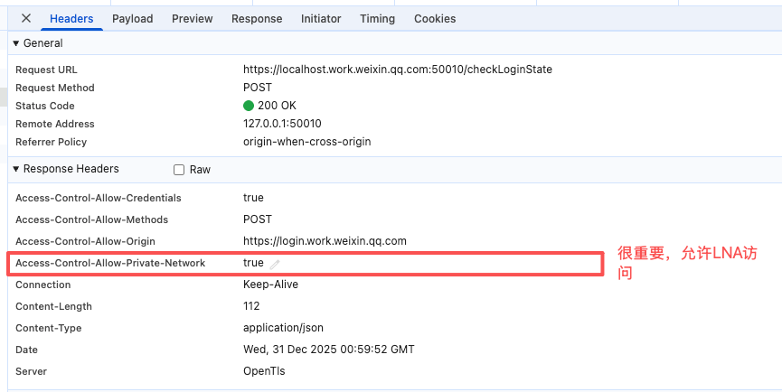

# 从“公司能用、客户不行”说起：Chrome Local Network Access 实战笔记

>最近一个做前端的朋友，遇到了下面这个诡异的问题，最开始我以为是 CORS 设置的不对，但是一步步整理下来，原来是一个全新的chrome安全策略，LNA。
>下文以第一人称来记录问题

## 一个很诡异的问题：昨天还正常，今天客户那边全挂了

我最近在一个 PC 端项目里踩到了一个非常“反直觉”的坑。

项目背景很简单：

* 有一个 **PC 端 H5 页面**，运行在 Chrome 浏览器里
* 用户电脑上会安装一个 **本地软件**，这个软件会在本机启动一个 HTTP API（比如 `http://localhost:9001`）
* H5 页面通过 Ajax / fetch，直接调用这个本地 API 来查询数据

这套方案已经稳定跑了很久。

直到最近，有客户反馈：
**页面能打开，但一到调用本地接口就直接失败。**

Chrome 控制台里报了这么一条错（非常关键）：

```
Access to fetch at 'http://localhost:9001/callback/select_spu'
from origin 'http://14.11.243.112:9462'
has been blocked by CORS policy:
The request client is not a secure context and the resource is in more-private address space `loopback`.
```

第一反应很自然：

> CORS？跨域？后端 header 少配了？

但很快发现不对劲——
**在公司内部环境，我怎么都复现不了这个问题。**

更离谱的是：

* 同一个测试人员
* 同一台电脑
* 同一个 Chrome（版本 143）
* 页面和本地软件完全一致

唯一的区别只有一个：

* **客户环境**：
  H5 地址是 `http://14.xx.xx.xx:9462`（公网 IP）
* **公司环境**：
  H5 地址是 `http://192.168.209.62:9562`（内网 IP）

而且两边**都是 HTTP**，不是 HTTPS。

结果却是：

* 公司内网：可以正常调用 `localhost`
* 客户环境：Chrome 直接拦截，连请求都没发出去

**THERE MUST BE SOMETHING WRONG**。

---

## 这不是传统 CORS，而是 Chrome 的 Local Network Access（LNA）

顺着错误信息里的关键词 `more-private address space loopback`，我最终定位到了一个很多前端其实并不熟的东西：

> **Chrome Local Network Access（LNA，本地网络访问）**

这是 Chrome 近几年在逐步推进的一套安全策略，目标只有一个：

> **防止“公网网页”随意访问用户的内网或本机服务**

这类攻击在安全领域有个很经典的模型：

* 一个公网网站
* 在你浏览器里运行
* 偷偷扫描你本机或内网端口
* 调用本地服务、路由器、开发工具、企业 Agent……

Chrome 的 LNA，就是专门干这个的。

---

## Chrome 是怎么判断“这是一次本地网络访问”的？

关键不在于 **“是不是 localhost”**，而在于 **IP 地址空间的级别**。

Chrome（准确说是 WICG 规范）把网络地址分成了三类：

### 1️⃣ loopback（回环地址）

最私有的一类，只能访问本机：

* `localhost`
* `127.0.0.1`
* `::1`

### 2️⃣ local（本地 / 内网地址）

局域网或链路本地：

* `192.168.x.x`
* `10.x.x.x`
* `172.16.x.x ~ 172.31.x.x`
* `169.254.x.x`

### 3️⃣ public（公网地址）

除此之外，全部都是 public。

---

### 核心判定规则只有一句话：

> **如果请求目标的地址空间，比页面所在的地址空间“更私有”，那这就是一次 Local Network Access 请求。**

私有程度排序是：

```
loopback > local > public
```

---

## 一个非常关键、也是我这次踩坑的前提条件

根据 Chrome 官方在
《New permission prompt for Local Network Access》这篇文章里的说明：

> **当前阶段（ Chrome >= 142版本），Chrome 只默认限制：**
> **public → local / loopback**
>
> **暂时还没有限制：**
> **local → local / loopback**

这一点非常重要。

也正是它，解释了我遇到的所有“诡异现象”。

---

## 回到最开始的问题：为什么公司能用，客户那边不行？

我们把两种环境，用 Chrome 的地址空间模型重新梳理一遍。

### ① 客户环境（被拦截）

* 页面 origin：
  `http://14.xx.xx.xx:9462` → **public**
* 请求目标：
  `http://localhost:9001` → **loopback**

这是一次非常典型的：

```
public → loopback
```

而且页面还是 **HTTP**，不是安全上下文。

结果就是：

* Chrome 直接在浏览器层面拦截
* **不会弹任何 LNA 权限提示**
* 控制台只留下那条我们看到的错误

这和我的实测完全一致：

* `window.isSecureContext === false`
* 没有任何授权机会
* 请求直接被挡在浏览器里

---

### ② 公司内网环境（可以访问）

* 页面 origin：
  `http://192.168.209.62:9562` → **local**
* 请求目标：
  `http://localhost:9001` → **loopback**

这是一次：

```
local → loopback
```

**而这类请求，在当前阶段是“尚未被 Chrome 默认限制的”。**

所以：

* 即使是 HTTP
* 即使 `window.isSecureContext === false`
* 即使没有弹出 LNA 权限提示

Chrome 也**不会拦**。

这就完美解释了：

> 为什么同一台电脑、同一个 Chrome、同样是 HTTP，
> 在公司可以，在客户那边却直接被阻止。

---

## 这件事给我的几个重要认知刷新

### 这真的不是 CORS

* 改 `Access-Control-Allow-Origin` 没用
* Nginx、后端都救不了
* 因为请求压根没离开浏览器

###  “能不能访问 localhost”，取决于**页面来自哪里**

不是你请求了什么，而是：

> **Chrome 在问：这个页面，有没有资格碰用户本机？**

### 内网部署 ≠ 公网部署

在 LNA 规则下：

* 内网 H5
* 公网 H5

**安全级别已经完全不一样了。**

---

## 在 LNA / PNA 时代怎么把「H5 → 本地服务」做成 Chrome 允许的

**注意**：这里说的是从 `public` 到 `local` 或者 `loopback` 的LNA请求。因为 `local` 到 `loopback` 的请求目前chrome还没有拦截。

我把适配拆成两件事：**H5 侧怎么发**、**本地 server 怎么回**。只要两边都做到位，Chrome 才会放行。

---

### 一、H5 侧我会做什么

#### 1）先判断自己有没有资格（必须是安全上下文）

```js
if (!window.isSecureContext) {
  throw new Error("This page is not a secure context (HTTPS required for LNA).");
}
```

#### 2）查询 LNA 权限状态（新权限名：local-network-access）

```js
navigator.permissions.query({ name: "local-network-access" })
  .then((result) => {
    console.log(`LNA permission state: ${result.state}`); // "granted" | "prompt" | "denied"
  });
```

#### 3）发请求时显式声明我要访问的地址空间（重点：targetAddressSpace）

* 访问内网 IP（local）时：

```js
await fetch("http://192.168.1.10:9001/api/status", {
  targetAddressSpace: "local",
});
```

* 访问本机服务（loopback，例如 localhost/127.0.0.1）时：

```js
await fetch("http://127.0.0.1:9001/checkLoginState", {
  targetAddressSpace: "loopback",
});
```

我会把这当成“声明意图”：让浏览器明确知道这次请求是 LNA，并走相应的安全校验流程（包括触发 PNA 预检）。

---

### 二、本地 server 侧我必须做什么（否则一定被拦）

Chrome 进入 PNA/LNA 流程后，会先发一个 **OPTIONS 预检**，本地 server 必须正确响应。

**必须支持 OPTIONS，并返回这些头（核心）**

```http
HTTP/1.1 204 No Content
Access-Control-Allow-Origin: https://xxxxx
Access-Control-Allow-Methods: GET, POST, OPTIONS
Access-Control-Allow-Headers: Content-Type
Access-Control-Allow-Private-Network: true
Vary: Origin
```

其中这条是“生死线”：

* `Access-Control-Allow-Private-Network: true`

不返回它，Chrome 会直接判失败（即使普通 CORS 都配对了也没用）。

---

## 真实案例：企微在线文档本地登录

根据上面梳理的知识，正好联想到最近企业微信的在线文档，貌似使用电脑本地的企微一键登录功能丢失了，之前访问企微在线文档的时候，如果当前电脑本地登录了企业微信客户端，一般会优先显示一个本地企微一键登录，只需要点击一个登录按钮就OK了，但是现在看不到这个按钮了，只有企微扫码登录。

会不会和这个chrome最新的LNA安全策略有关系呢？

首先，我打开一个企微文档的浏览器登录页面
>https://doc.weixin.qq.com/doc/w3_AKJOFDNFADSJFSADO79FDSAK?scode=ACL0003LDFJSAOFSO

我发现这个页面会调用一个请求：
>https://localhost.work.weixin.qq.com:50010/checkLoginState

看到这个域名还挺直观的，很自然联想到这是解析到本地的一个域名，验证如下：
```shell
dig localhost.work.weixin.qq.com

; <<>> DiG 9.10.6 <<>> localhost.work.weixin.qq.com
;; global options: +cmd
;; Got answer:
;; ->>HEADER<<- opcode: QUERY, status: NOERROR, id: 13988
;; flags: qr rd ra; QUERY: 1, ANSWER: 1, AUTHORITY: 0, ADDITIONAL: 1

;; OPT PSEUDOSECTION:
; EDNS: version: 0, flags:; udp: 512
;; QUESTION SECTION:
;localhost.work.weixin.qq.com.	IN	A

;; ANSWER SECTION:
localhost.work.weixin.qq.com. 606 IN	A	127.0.0.1

;; Query time: 34 msec
;; SERVER: 114.114.114.114#53(114.114.114.114)
;; WHEN: Wed Dec 31 08:09:46 CST 2025
;; MSG SIZE  rcvd: 73
```

果然，这个域名是解析到 **127.0.0.1** 的。

同时在chrome的console里，找到了如下错误：
>Access to fetch at 'https://localhost.work.weixin.qq.com:50010/checkLoginState' from origin 'https://login.work.weixin.qq.com' has been blocked by CORS policy: Request had a target IP address space of `unknown` yet the resource is in address space `unknown`.

这里很奇怪，chrome把网页和目标域名都判定成了  `unknown`，而不是 `public`  和 `loopback`。但是翻了相关文档，请教了ChatGPT，都没找到chrome官方有说明什么情况会把域名/ip判断为 `unknown`，反正结论就是这样的LNA请求也会直接被chrome拦截。

**猜测可能是本机开了VPN导致的，当我关闭VPN之后，H5里的企微一键登录又正常了**。可以看到chrome弹出了LNA请求的prompt：


话说，这个弹窗好像最近我确实看到过，当时没细想是做什么的，原来是chrome的LNA授权确认弹窗啊……

我点击了允许之后，可以看到上述请求已经成功了：




## 写在最后

这次问题，**如果一直停留在“是不是 CORS 配错了”这个层面，其实永远想不通**。

真正发生变化的，不是某个接口、某个请求头，而是 Chrome 看待“网页”的方式变了：

> **网页，不再只是展示 UI 的壳子，而是一个可能触达本机和内网的入口。**

Local Network Access 也不是一个“可选特性”，而是浏览器明确划下的一条安全边界。

以后凡是涉及：

* PC 端 H5
* 本地 Agent / 客户端
* 内网或政企系统

都绕不开这个问题。

如果你现在还没遇到，大概率只是**场景还没刚好触发**；
一旦触发，排查成本会非常高。

我踩完这个坑后的结论很简单：

> **别再指望“以前能用”，而是尽早按 LNA 的规则来设计。**

这不是修 bug，这是跟上时代。


## 相关链接

* [Feature: Local network access restrictions](https://chromestatus.com/feature/5152728072060928)
* [New permission prompt for Local Network Access](https://developer.chrome.com/blog/local-network-access)
* [non-public-ip-address-blocks](https://wicg.github.io/local-network-access/#non-public-ip-address-blocks)
* [https://developer.chrome.com/blog/private-network-access-preflight](https://developer.chrome.com/blog/private-network-access-preflight)
* [ Adapting your website for new Local Network Access restrictions in Chrome](https://docs.google.com/document/d/1QQkqehw8umtAgz5z0um7THx-aoU251p705FbIQjDuGs/edit?tab=t.0#heading=h.v8oobsqxbxxy)